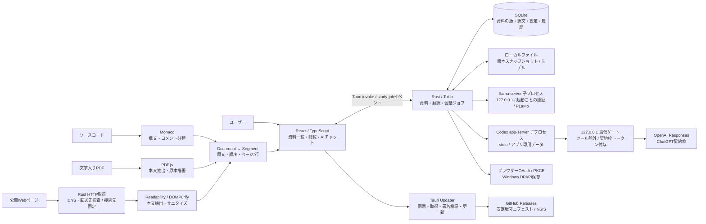
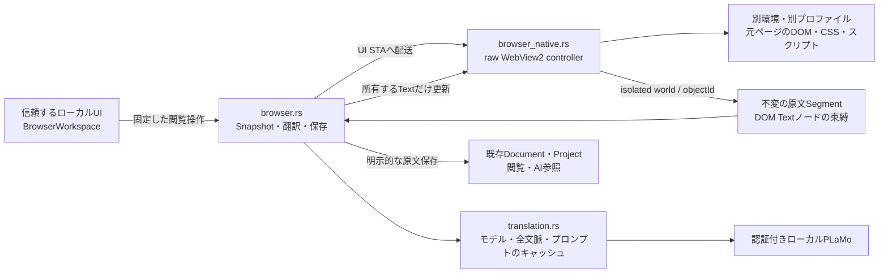
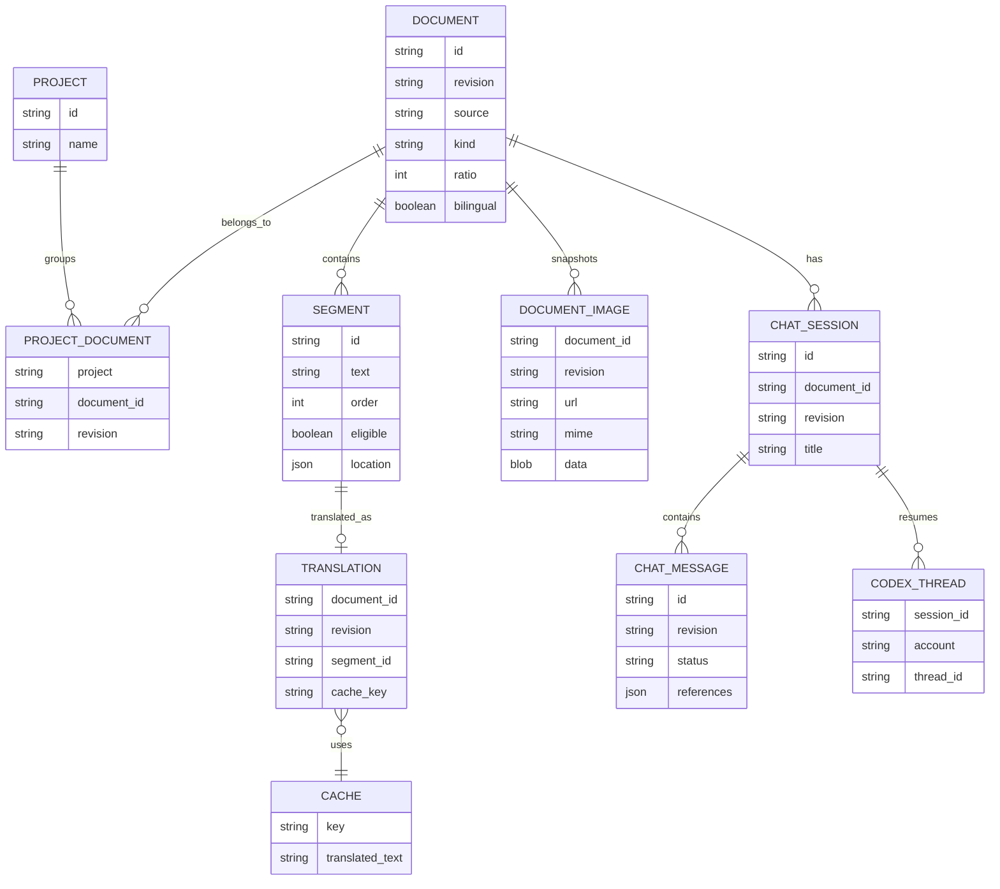
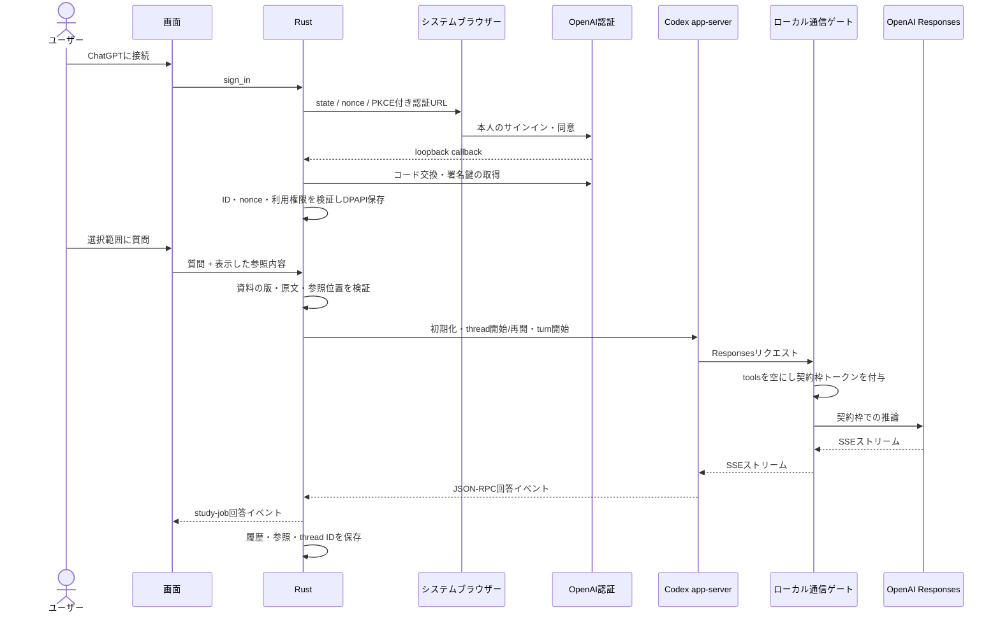
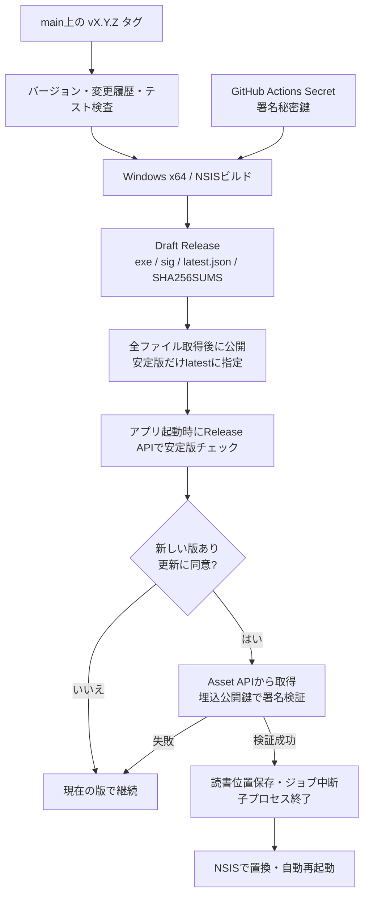

# Gradiaのアーキテクチャ

Gradiaは技術資料の閲覧・部分翻訳・AIへの質問を一つの画面で行うWindows 11 x64向けのアプリです。

## 全体構成

UIはTauriのWebView内で動きます。ファイルアクセス、HTTP取得、子プロセスの管理、SQLiteの操作、資格情報の管理はRustが担当します。取り込んだWebページのスクリプトは実行しません。

## 元ページの閲覧と翻訳

元ページの閲覧はTauri管理のリモートWebViewを使いません。通常のTauri初期化スクリプトが入る構成では、元サイトへ内部APIが露出するためです。Rustが別環境のraw WebView2を作り、両環境の実際のUserDataFolderが異なることを確認します。Webメッセージ・ホストオブジェクトを無効にし、Tauriのプロトコル・invokeハンドラー・資格情報を登録しません。信頼する画面のCSPは変更しません。

COMオブジェクトはUI STAの所有者にだけ保持します。非同期側へ渡すのは操作データと結果だけです。終了時は初期化とCDPの未完了応答を所有者が中断し、遅いコールバックを無視します。WebView2はClose後にコールバックを返さない場合があるため、終了をコールバック任せにしません。

本文はisolated worldの固定スクリプトで解析します。メインworldの関数やDOM属性を権限確認に使いません。最大30,000テキストノードを走査し、最大2,000文・200,000文字を保持します。14,000 UTF-16単位を超えるノードは読み飛ばし、一部のみの解析として表示・保存時の注記へ伝えます。コード・数式要素・入力・編集可能・非表示・フレームの内容は対象外です。画面外の本文も対象ですが、DOM変更を監視して翻訳し続ける処理はありません。

ページの世代、isolated worldのuniqueContextId、元DOMを保持するobjectIdをRust内部に置きます。全文の移動・同じURLの再読み込み・同一文書内のURL変更で世代と中断トークンを更新し、前の結果を適用しません。再解析前に以前の束縛を使って所有する変更を原文へ戻します。同一文書内の移動で訳文を新しい原文として取り込まないためです。DOMノードの接続と最後に書いた文字列の一致を確認し、サイト側が変更・交換したノードは上書きしません。翻訳結果はText.dataへ書き、生HTMLとして挿入しません。

翻訳対象の選択は既存の`chosenSegments`と同じ固定順位を使い、Rustは現在のスナップショットへの所属を検証します。ローカル翻訳のプロンプト・原文の周辺文脈・モデル識別は既存の資料翻訳と共通です。ブラウザーのキャッシュは資料の訳文テーブルへ結び付けません。ジョブは既存の中断管理に登録し、通知は信頼するmain画面だけの`browser-job`へ送ります。

HTTP・HTTPSの通常のブラウザー通信を行います。トップレベルの非HTTPスキーム・ローカルアドレスの直接指定、権限要求、ダウンロード、外部アプリ起動、証明書の無視、Basic認証は拒否します。利用者が押したHTTP・HTTPSの新規ウィンドウリンクは同じ領域で開きます。サイトのリソース通信には、記事取り込みのDNS固定・公開IP検査は適用しません。

ブラウザーは別のワークスペースです。入る際に既存資料の翻訳・回答を中断します。資料や設定へ戻る前にネイティブ子画面を閉じます。原文を保存するときだけ、原文Segment・元URL・タイトル・安定したアンカーと選択プロジェクトを既存Documentへ保存します。AIはその保存した版の原文を参照します。

## 資料・翻訳のモデル

- 同じ取得元の内容が変わると、新しいrevisionとして保存します。過去の会話は過去の版を参照します。
- スライダーは翻訳可能な文を文書順に並べ、文の番号の2進数を逆順の小数にした固定順位で選びます。50%では1文おきに日本語になり、他の割合でも文書全体に分散します。割合ごとに位置を選び直さないため、割合を増やしても選択済みの文が原文へ戻ることはありません。コード・数式などの対象外の要素は、文数にも順位にも含めません。
- 訳文のキーにはモデルハッシュ、PFML3プロンプト、周辺原文を含めます。コード・数式は保護し、復元を検証できない訳文は採用しません。
- 表示モードは資料の版ごとの`bilingual`に保存し、既存資料は`false`として読み込みます。併記中は表示割合を100%相当として翻訳対象を選びますが、保存した`ratio`は上書きしません。原文の下に同じ文IDの訳文を表示し、割合モードへ戻すと元の割合とキャッシュを再利用します。選択範囲・AIの参照位置は両モードで同じです。
- PDFはページと矩形、コードは行、Webは本文ブロックの位置を保持します。複雑なPDFの読順は原本で補います。

## 資料の削除

資料の削除とプロジェクトからの除外を分けます。削除では指定した版、または同じ資料IDの全版を対象に、資料・プロジェクトとの関連・訳文・会話・Codexの再開IDをSQLiteの1トランザクションで取り除きます。他の訳文から参照されるキャッシュは保持します。

削除とジョブ開始を同じゲートで直列化し、実行中のジョブを中断して終了を待ってから削除します。終了待ちが失敗した場合は削除しません。削除済みの資料に対する遅い書き込みもDBで拒否します。

保存コピーは原本とは別です。残る資料と取り込み途中のファイルのハッシュを調べ、参照がないコピーだけを削除します。ファイル削除の失敗はDBの削除成功と区別して表示します。取得元のローカルファイルやWebページは変更しません。

## Markdownプレビューと翻訳

remarkのCommonMark・GFM・数式構文を解析し、見出し・リスト・引用・表の構造を保ったまま、本文・見出し・表のセルを文単位に分割します。インライン書式を各文の範囲で切り出し、コード・数式・画像を文境界の判定から除外します。元のブロックの行範囲と見出しアンカーを`Segment.location`に保持します。

原本のMarkdownは`Document.content`に保存します。`language: markdown`の資料は本文を解析し直してReactの要素として表示し、生HTMLをDOMへ挿入しません。訳文も同じ許可済み要素で表示し、外部リンクはhttp/httpsに制限します。画像は保存済みのコピーだけを表示し、閲覧時にネットワークや元ファイルへアクセスしません。コードと数式は翻訳対象外です。

翻訳割合・併記・原文確認は他の資料と共通の`SegmentView`を使います。PLaMoへの入力では、インラインコード・数式・リンク先・書式記号を保護し、保持を確認できない訳文は採用しません。複数バッククォートや括弧を含むリンク先も保護します。

資料の版は`markdown-v1`という処理識別子、元の本文、抽出した文の内容・位置から生成します。表示時の再解析結果と保存済みの文が一致しなければ、古い訳文を新しい文へ結び付けず、新しいプレビュー版への更新を案内します。旧形式の資料は、保存済み本文から新しい版を作成し、本文・過去の会話・旧版の参照先を保持します。プロジェクトの関連は新しい版にも追加します。

ページ分割は文数80件を目安にトップレベルのブロック境界で行い、表やリストを途中で分断しません。1つの長いブロックは80件を超えて同じページに表示します。

### フォルダー内の画像

フォルダー走査で返したMarkdownに、そのフォルダーの取り込み権限を一時的に紐づけます。通常のファイル追加では画像を読み込みません。UIがMarkdownの画像記法・参照定義を抽出し、Rustが保存時に元ファイルからの相対パスを解決します。フォルダー内のパスであることと、途中にシンボリックリンク・ジャンクションがないことを確認してから正規化します。リンク先のネットワーク共有へ検査時にアクセスすることも防ぎます。絶対パス・ネットワークパス・URL・NTFSの代替データストリーム参照も拒否します。

拡張子ではなく内容の識別子でPNG・JPEG・GIF・WebPを判定します。SVG・HTMLは取り込みません。1枚10 MB、資料ごとに合計40 MB・参照256件を上限とし、容量を確認してから読み込みます。失敗は注記に残し、本文の保存は継続します。

画像は`document_images`へ元URL・MIME・バイナリーを保存し、資料とプロジェクト登録を同じトランザクションで確定します。URLと内容ハッシュを資料の版に含め、画像だけが変わった場合も過去の表示と会話を保持します。プレビューの更新では保存済み画像を引き継ぎ、資料の版を削除すると外部キーで対応する画像も削除します。既存DBには画像テーブルを追加します。

UIは表示中のMarkdownの画像だけを取得し、許可した画像MIMEのdata URLとして表示します。Markdownや訳文のURLを直接`img.src`へ渡さず、CSPも変更しません。保存済み画像がない場合やデコードに失敗した場合は代替テキストを表示します。

## 会話セッション

同じ資料の版に複数の`chat_sessions`を作成します。`session_messages`と`session_threads`はセッションへの外部キーを持ち、Codexの再開IDはセッションと認証アカウントの組で保存します。質問前に資料ID・版・セッションの一致をRustで確認します。新しい会話には他の会話の再開IDを渡しません。

DBの版3への移行はトランザクションで行います。旧形式のメッセージと再開IDを、資料の版ごとに「以前の会話」へ移し、重複移行を防ぎます。回答途中で終了したメッセージは再起動時に中断状態にします。

UIは資料の版とセッションIDを合わせて回答イベントを振り分けます。会話を切り替えると現在の回答を中断し、遅れて返った開始結果も中断します。前の会話のイベント・履歴取得結果が選択中の履歴を上書きしないようにします。翻訳の表示とジョブは資料の版の単位を維持します。

### 会話の削除

削除対象の資料ID・版・セッションIDを検証し、その会話に属する回答ジョブだけを中断して終了を待ちます。ジョブ開始と削除は同じゲートを使います。終了待ちに失敗した場合は履歴を保持して再試行を案内します。

`chat_sessions`の削除で、外部キーにより`session_messages`と`session_threads`を同時に削除します。消えたセッションへの書き込みは拒否し、遅い回答が会話を復活させないようにします。資料を削除した場合も同じ外部キーが働きます。資料・翻訳・別の会話は会話削除の対象に含めません。

削除するのはGradiaのSQLite上の履歴とCodexの再開IDです。Codex app-serverが別途保持するログやOpenAI側のデータを削除する操作ではありません。

## プロジェクトと一括取り込み

プロジェクトは資料の版への参照を持つコレクションです。同じ資料を複数のプロジェクトに登録しても、本文・訳文・会話を複製しません。削除・除外は関連だけを消し、資料を保持します。資料の更新で新しい版を取り込んだ場合も、過去の版の登録は残します。

SQLiteの`projects`・`project_documents`に名前と関連を保存します。既存DBにはテーブルを追加し、既存資料を「すべての資料」から引き続き表示します。資料の保存とプロジェクトへの関連追加は同じトランザクションで行い、存在しないプロジェクトへの取り込みは資料も保存せず失敗します。選択中のプロジェクトとプロジェクトごとの直近の資料はUIのローカルストレージに保存します。

複数ファイルの選択結果と、Rustで再帰走査したフォルダーの対応ファイルを、同じ取り込み処理へ渡します。メモリー使用を抑えるため1ファイルずつ読み込み・抽出・保存し、1件の失敗で残りを止めません。完了した資料と個別の失敗理由を最後に表示します。中断は処理中のファイルを保存した後に反映します。依存・生成物のディレクトリを除外し、サブフォルダーのシンボリックリンクはたどりません。ファイルサイズ・件数の上限は通常の読み込みと共通です。

AIの参照範囲と会話の保存単位は資料の版のままです。プロジェクト内全資料の横断検索・一括送信や、プロジェクト固有のAI指示は実装していません。

## 質問と認証

既存Codexアプリの資格情報は読みません。GradiaのOAuth登録を利用します。子プロセスに渡すのはローカルゲート専用の一時トークンで、OpenAIのアクセストークンはRust側に保持します。APIキーへの自動切り替えはありません。

## リリースと更新

更新確認では公開GitHub Releaseだけを参照し、資料や認証情報をGitHubへ送りません。更新を拒否した場合はインストーラーのダウンロードもインストールもしません。起動時にオフラインであっても閲覧を継続でき、ヘッダーのバージョンボタンから更新を再確認できます。

保存先の識別子は旧名との互換性のため`local.study-tool.desktop`を維持します。更新でSQLite・モデル・暗号化資格情報を削除しません。

## コードの配置

| 場所                                   | 担当                                  |
| -------------------------------------- | ------------------------------------- |
| `src/App.tsx` / `components.tsx`       | 3ペイン、PDF原本、コード、設定        |
| `src/core.ts` / `importers.ts`         | 文分割、順位、保護、資料抽出          |
| `src/UpdateControl.tsx` / `updater.ts` | 更新確認と同意、進捗                  |
| `src-tauri/src/updates.rs`             | Release API・配布物の解決と版の検査    |
| `src-tauri/src/files.rs` / `store.rs`  | 原本・版・SQLite                      |
| `src-tauri/src/web.rs`                 | 公開IP検査・DNS固定・転送と受信量制限  |
| `src-tauri/src/translation.rs`         | PLaMo子プロセスとキャッシュ           |
| `src/BrowserWorkspace.tsx` / `browser.ts` | 元ページの閲覧操作・翻訳表示・原文保存 |
| `src-tauri/src/browser.rs` / `browser_native.rs` | スナップショット・中断・raw WebView2の所有 |
| `src-tauri/src/browser_dom.js` / `browser_apply.js` | isolated world内の固定DOM操作 |
| `src-tauri/src/auth.rs` / `codex.rs`   | OAuth・DPAPI・Codex・ゲート           |
| `src-tauri/src/lib.rs`                 | IPC登録、ジョブ管理、更新前の終了処理 |
| `scripts/*release*.mjs`                | 版検査、更新マニフェスト、Release公開 |
| `.github/workflows/release.yml`        | タグから署名付きWindows版を公開       |

開発手順は[development.md](development.md)、運用規約は[releasing.md](releasing.md)を参照してください。
