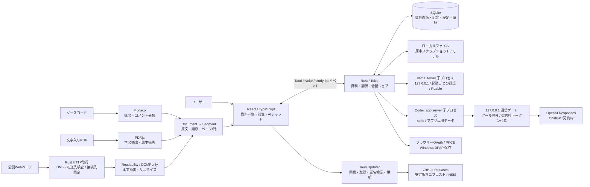
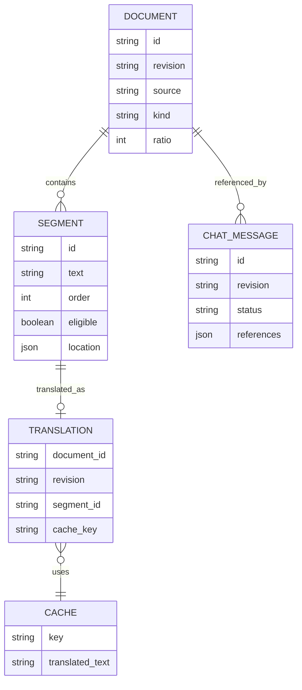
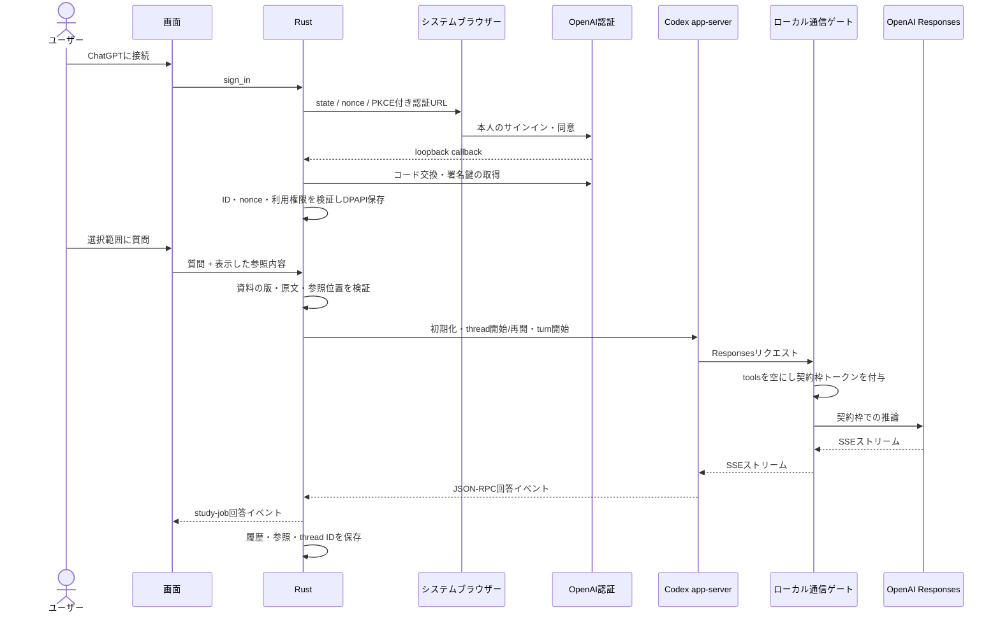
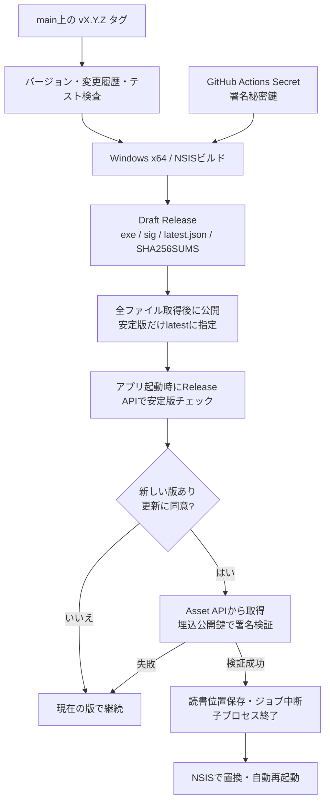

# Gradiaのアーキテクチャ

GradiaはWindows 11 x64向けの、技術資料の閲覧・部分翻訳・AIへの質問を一つの画面で行うアプリです。

## 全体構成

UIはTauriのWebView内で動き、ファイルアクセス、HTTP取得、子プロセス、SQLite、資格情報はRustが担当します。取り込んだWebページのスクリプトは実行しません。

## 資料・翻訳のモデル

- 同じ取得元の内容が変わると、新しいrevisionとして保存します。過去の会話は過去の版を参照します。
- スライダーは翻訳可能な文を固定順位で選び、表示を切り替えます。割合の増加で選択済みの文が原文へ戻ることはありません。
- 訳文のキーにはモデルハッシュ、PFML3プロンプト、周辺原文を含めます。コード・数式は保護し、復元を検証できない訳文は採用しません。
- PDFはページ・矩形、コードは行、Webは本文ブロックの位置を保持します。複雑なPDFの読順は原本で補います。

## 質問と認証

既存Codexアプリの資格情報は読みません。GradiaのOAuth登録を利用します。子プロセスに渡すのはローカルゲート専用の一時トークンで、OpenAIのアクセストークンはRust側に保持します。APIキーへの自動切り替えはありません。

## リリースと更新

更新確認の通信は公開GitHub Releaseだけを参照します。資料や認証情報をGitHubへ送りません。拒否した場合はインストーラーのダウンロードもインストールもしません。起動時にオフラインであっても閲覧を継続し、ヘッダーのバージョンボタンから再確認できます。

保存先の識別子は旧名との互換性のため`local.study-tool.desktop`を維持します。更新でSQLite・モデル・暗号化資格情報を削除しません。

## コードの配置

| 場所                                   | 担当                                  |
| -------------------------------------- | ------------------------------------- |
| `src/App.tsx` / `components.tsx`       | 3ペイン、PDF原本、コード、設定        |
| `src/core.ts` / `importers.ts`         | 文分割、順位、保護、資料抽出          |
| `src/UpdateControl.tsx` / `updater.ts` | 更新確認と同意、進捗                  |
| `src-tauri/src/updates.rs`             | Release API・配布物の解決と版の検査    |
| `src-tauri/src/files.rs` / `store.rs`  | 原本・版・SQLite                      |
| `src-tauri/src/web.rs`                 | 公開IP検査・DNS固定・転送と受信量制限  |
| `src-tauri/src/translation.rs`         | PLaMo子プロセスとキャッシュ           |
| `src-tauri/src/auth.rs` / `codex.rs`   | OAuth・DPAPI・Codex・ゲート           |
| `src-tauri/src/lib.rs`                 | IPC登録、ジョブ管理、更新前の終了処理 |
| `scripts/*release*.mjs`                | 版検査、更新マニフェスト、Release公開 |
| `.github/workflows/release.yml`        | タグから署名付きWindows版を公開       |

開発手順は[development.md](development.md)、運用規約は[releasing.md](releasing.md)を参照してください。
