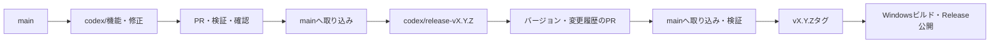

# ブランチ運用

## 通常の変更

`main`は取り込みとリリースの基準です。機能追加、不具合修正、文書変更は、最新の`origin/main`から短い作業ブランチを作り、PRで取り込みます。`main`へ直接pushしません。

```powershell
git fetch origin
git switch -c codex/add-projects origin/main
```

ブランチ名は`codex/変更の目的`とします。1つのPRは、まとめて確認・取り消しできる範囲に絞ります。並行する別の変更は、作業中のブランチではなく`origin/main`から分けます。依存する変更を同じPRに含める場合は、その関係をPR本文に記載します。



## コミットとPR

- コミットは論理単位に分け、変更が必要な理由を記録します。コードにはHow、テストにはWhat、コードコメントにはWhy notを記載します。
- PRには、解決する問題、変更後の動作、実施した検証、残る制約を記載します。
- コード変更はWindows checksの成功を確認してから取り込みます。文書だけのPRではCIが省略されるため、リンク・図・手順を確認します。
- 取り込み方法は原則としてmerge commitです。理由ごとに分けたコミットを残します。公開済みブランチのforce-pushや公開済みコミットの書き換えは行いません。
- 競合があれば`origin/main`を作業ブランチへmergeし、影響する検証を再実行します。
- PRを取り込んだら、作業ブランチをローカル・GitHubから削除します。

個人開発でもPR本文と差分を確認してから取り込みます。第三者の承認を必須とはしません。この文書は運用規約であり、GitHubのブランチ保護設定を自動的に変更するものではありません。

## リリースと緊急修正

リリース準備も`main`から分けたブランチとPRを使います。タグはPRを取り込んだ`main`上のコミットに付け、常設のリリースブランチは設けません。具体的な手順、RC、将来の保守ブランチは[リリース規約](releasing.md)に記載します。

緊急修正も最新の`origin/main`から`codex/fix-問題`を作り、PRと検証を省略しません。取り込み後にPATCH版を準備します。`main`に未公開の機能がある場合は、その機能を含む版として公開可能か確認し、公開できない変更はPRでrevertしてから修正版を準備します。配布済みタグやバイナリの上書きは行いません。
