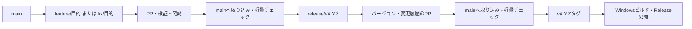

# ブランチ運用

## 通常の変更

`main`は取り込みとリリースの基準です。機能追加、不具合修正、文書変更は、最新の`origin/main`から短い作業ブランチを作り、PRで取り込みます。`main`へ直接pushしません。

```powershell
git fetch origin
git switch -c feature/add-projects origin/main
```

ブランチ名は変更の種類で分けます。目的は短い英語のハイフン区切りで表します。

| 用途 | 形式 | 例 |
| --- | --- | --- |
| 機能追加・改善・文書整備 | `feature/<目的>` | `feature/add-projects` |
| 不具合・セキュリティ修正 | `fix/<目的>` | `fix/restore-reading-position` |
| リリース準備 | `release/vX.Y.Z` | `release/v0.3.0` |

1つのPRは、まとめて確認・取り消しできる範囲に絞ります。並行する別の変更は、作業中のブランチではなく`origin/main`から分けます。依存する変更を同じPRに含める場合は、その関係をPR本文に記載します。



## コミットとPR

- コミットは論理単位に分け、変更が必要な理由を記録します。コードにはHow、テストにはWhat、コードコメントにはWhy notを記載します。
- PRのDescriptionは`Summary`、`What Changed`、`Why`の3項目のみを、この順に記載します。概要、変更内容、変更の必要性・判断理由をそれぞれの項目にまとめ、他の見出しや前置きは追加しません。
- コード変更は最新の`main`を反映し、PRのWindows checks（`test`）が成功したことを確認してから取り込みます。検証後にmainが進んだ場合は、再度反映して検証します。文書だけのPRではCIが省略されるため、リンク・図・手順を確認します。
- mainへの取り込み後は整合性だけを確認する軽量チェック（`consistency`）を実行します。全テストとWindowsインストーラー生成はPR・手動実行・リリースタグで行います。
- 取り込み方法は原則としてmerge commitです。理由ごとに分けたコミットを残します。公開済みブランチのforce-pushや公開済みコミットの書き換えは行いません。
- 競合があれば`origin/main`を作業ブランチへmergeし、影響する検証を再実行します。
- PRを取り込んだら、作業ブランチをローカル・GitHubから削除します。

個人開発でもPR本文と差分を確認してから取り込みます。第三者の承認を必須とはしません。この文書は運用規約であり、GitHubのブランチ保護設定を自動的に変更するものではありません。

## リリースと緊急修正

リリース準備は`main`から`release/vX.Y.Z`を分けてPRを作ります。タグはPRを取り込んだ`main`上のコミットに付け、準備ブランチは取り込み後に削除します。具体的な手順とRCの扱いは[リリース規約](releasing.md)に記載します。

緊急修正も最新の`origin/main`から`fix/<目的>`を作り、PRと検証を省略しません。取り込み後にPATCH版を準備します。`main`に未公開の機能がある場合は、その機能を含む版として公開可能か確認し、公開できない変更はPRでrevertしてから修正版を準備します。配布済みタグやバイナリの上書きは行いません。
